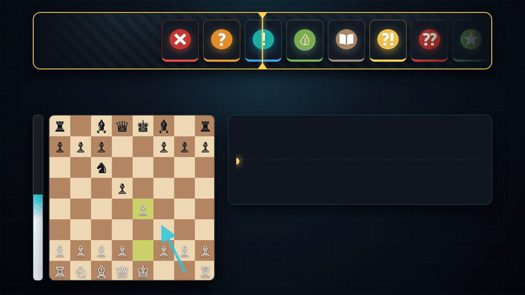

<div align="center">

  

  # Chess Game Analyzer

  **Desktop chess analysis workstation powered by Stockfish 17.1, Lichess opening classification, and custom annotations.**

  
  
  
  
  

  ---

  ### 🎬 Feature Showcase

  

</div>

---

## ⚡ Key Highlights

<table>
  <tr>
    <td width="50%">
      <h3>🎯 Precision Move Classification</h3>
      Every move is mapped through non-linear win-probability curves, detecting tactical turnarounds, sacrifices, misses, and book moves in real-time.
    </td>
    <td width="50%">
      <h3>↗️ Alternative Move Hints</h3>
      On blunders, mistakes, inaccuracies, or misses, visual on-board arrows point straight to the engine's recommended continuation.
    </td>
  </tr>
  <tr>
    <td width="50%">
      <h3>📈 Dynamic Evaluation & Accuracy</h3>
      Smooth live graph with hover inspections, synchronized dual-color POV eval bar, and phase-by-phase accuracy (Opening, Middlegame, Endgame, Rating).
    </td>
    <td width="50%">
      <h3>🎨 Hot-Reloadable MS Paint Customizer</h3>
      Edit any annotation badge directly in Microsoft Paint with one click, live in-app preview, and instant one-button reset.
    </td>
  </tr>
  <tr>
    <td width="50%">
      <h3>⚡ Unthrottled Background Queue</h3>
      Windows PowerThrottling bypass ensures Stockfish continues calculating at maximum CPU speed even when tabbed out or minimized.
    </td>
    <td width="50%">
      <h3>🔄 Perspective Auto-Flip</h3>
      Automatically rotates the board to your perspective whenever your username matches PGN headers.
    </td>
  </tr>
</table>

---

## 🏷️ Annotation System

| Badge | Annotation | Win% Loss / Criteria | Description |
|:---:|:---|:---:|:---|
|  | **Brilliant (`!!`)** | Loss ≤ 2% | Sound piece sacrifice leading to decisive advantage |
|  | **Great (`!`)** | Best move | Only winning move or major tactical turnaround |
|  | **Best (`★`)** | Best line | Top move selected by Stockfish MultiPV |
|  | **Excellent (`👍`)** | Loss ≤ 2% | Strong strategic choice keeping high win chance |
|  | **Good (`✓`)** | Loss ≤ 5% | Solid move without compromising position |
|  | **Book (`/`)** | Known Theory | Move cataloged in Lichess Opening Database (ECO A–E) |
|  | **Inaccuracy (`?!`)** | Loss 5–10% | Suboptimal play that reduces edge |
|  | **Mistake (`?`)** | Loss 10–20% | Concession causing positional damage |
|  | **Blunder (`??`)** | Loss > 20% | Critical blunder swinging game evaluation |
|  | **Miss (`✗`)** | Drop from win | Missed winning tactic or game-winning conversion |
|  | **Forced (`→`)** | 1 legal move | The only available legal move (excluded from accuracy) |

---

## ⌨️ Keyboard Shortcuts

| Shortcut | Action |
|:---|:---|
| <kbd>←</kbd> / <kbd>→</kbd> or <kbd>↑</kbd> / <kbd>↓</kbd> | Navigate previous / next move |
| <kbd>Home</kbd> / <kbd>End</kbd> | Jump to start position / final move |
| <kbd>Page Up</kbd> / <kbd>Page Down</kbd> | Fast-forward / rewind 10 plies |
| <kbd>F</kbd> | Flip board orientation |
| <kbd>B</kbd> | Calculate & show 3 engine lines for current move |
| <kbd>Ctrl</kbd> + <kbd>O</kbd> | Open PGN file |
| <kbd>Ctrl</kbd> + <kbd>S</kbd> | Save analysed game to Library |
| <kbd>Ctrl</kbd> + <kbd>L</kbd> | Open Saved Games Library |

---

## 🚀 Getting Started

### Running from Source
```powershell
# Clone the repository
git clone https://github.com/Flopper1-1/chess-analyzer.git
cd chess-analyzer

# Install dependencies
pip install -r requirements.txt

# Run the test suite
python -m pytest tests -q

# Launch the application
python main.py
```

### Building the Single-File Executable
```powershell
.\build.ps1
```
The compiled standalone binary will be created in `dist/ChessAnalyzer.exe`.

---

## 🎬 Remotion Showcase Suite

The showcase animation in this README is generated entirely through code using Remotion:

```powershell
cd showcase
npm install

# Live preview in browser with hot-reload
npx remotion preview

# Render to 1080p MP4
npx remotion render src/index.ts ChessAnalyzerShowcase out/showcase.mp4
```

---

## 📜 Credits & License

- **Stockfish 17.1**: [official-stockfish/Stockfish](https://github.com/official-stockfish/Stockfish) (GPLv3)
- **Opening Encyclopedia**: [lichess-org/chess-openings](https://github.com/lichess-org/chess-openings) (CC0)
- **Engine Bindings**: [niklasf/python-chess](https://github.com/niklasf/python-chess) (GPLv3)
- **GUI Framework**: [Qt / PySide6](https://www.qt.io/) (LGPLv3)
